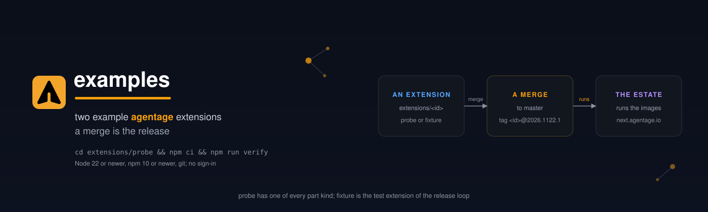

# examples



Two small agentage extensions that show how an extension is built and released. Use them to learn the shape, or copy one to start your own.

## Quick start

You need Node 22 or newer, npm 10 or newer and git.

```bash
git clone https://github.com/agentage/examples && cd examples/extensions/probe
npm ci
npm run verify
npx agentage extension check      # PASS probe <version> conforms (6 rules)
```

## What is in this repo

| Folder                                     | Id        | What it shows                                                         |
| ------------------------------------------ | --------- | --------------------------------------------------------------------- |
| [`extensions/probe`](extensions/probe)     | `probe`   | one of every part kind: pages, ui, api, mcp, worker, store, cli, app  |
| [`extensions/fixture`](extensions/fixture) | `fixture` | three parts (pages, api, app): the test extension of the release loop |

Each folder is a whole npm package with its own `package.json` and lock file. There are no npm workspaces. Each folder README says how to run it.

## How to work on it

Work inside one extension folder:

```bash
cd extensions/<id>
npm ci
npm run verify                    # type-check, lint, format, tests with coverage, build
npx agentage extension check      # the kit's six rules
```

CI runs `verify`, `check`, `agentage extension up --docker` and the e2e tests for each folder that a change touches. A change outside `extensions/` tests all folders. The job `ci-required` is green when all of them pass. A pull request is tested against the agentage/e2e branch of the same name when it exists, else the repo variable `E2E_REF`, else master.

To start a new extension, run `npx @agentage/cli@latest extension create <id> --no-install`. The template comes from [agentage/kit](https://github.com/agentage/kit).

## How a change is released

A merge to master is the release. `.github/workflows/release.yml` runs `agentage extension release --changed`.

- Only an extension whose folder changed since its last tag is released. Each extension gets its own version and tag.
- The version has the form `YYYY.MDD.N`: the year, the month times 100 plus the day, and the count of that day. Example: `2026.1122.3`.
- The tag has the form `<id>@<version>`, for example `probe@2026.1122.3`.
- The release pushes the images `ghcr.io/agentage/<id>-<part>` and `ghcr.io/agentage/<id>`. The release also publishes `@agentage/extension-probe` to npm with the same date version. `fixture` sets `"private": true` and is never on npm.
- Nobody bumps a version by hand. A released version never changes: a fix is a new merge.
- A change to a root-level `*.md` file or to `docs/` of an extension folder releases nothing. The same holds for the root `README.md`, `docs/` and `.github/` of this repo.
- To stop a folder from releasing, add a line to `.github/release-hold`: the folder name, then the reason. A line with no reason fails the run.
- Lock files: `extensions/<id>/package-lock.json` is the only lock file of an extension. A change to it releases that extension.

More: [docs/release.md](docs/release.md).

## For agents

```bash
cd extensions/probe && npm ci && npm run verify && npx agentage extension check
```

- Required CI check: `ci-required`. Local gate: `npm run verify` in the folder you changed.
- Never edit `openapi.json` or `probe.mcpc.json` by hand. They are generated; `agentage extension check --write` refreshes them.
- Never tag, publish or run the release workflow by hand. A merge to master releases.
- Run `agentage extension up`, `install`, `setup` and `update` only in a throwaway environment: they change the local daemon.
- Run `agentage extension create` with `--no-install`.
- Deeper rules: [CLAUDE.md](CLAUDE.md) (`AGENTS.md` links to it), one per extension folder, and [docs/release.md](docs/release.md).

## Related

- [agentage/kit](https://github.com/agentage/kit): the kit and the extension template.
- [agentage/cli](https://github.com/agentage/cli): the `agentage` command.

## License

MIT. See [LICENSE](LICENSE).
